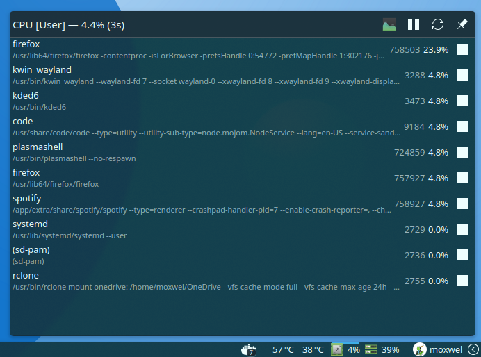
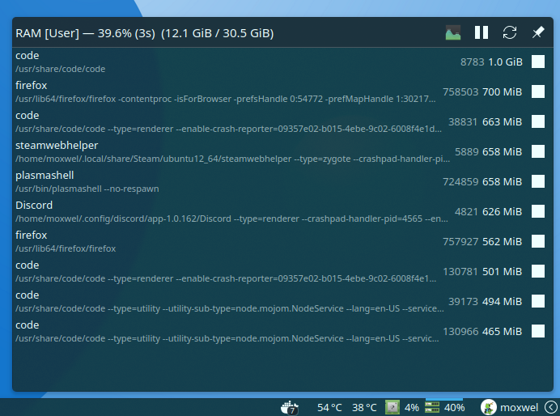
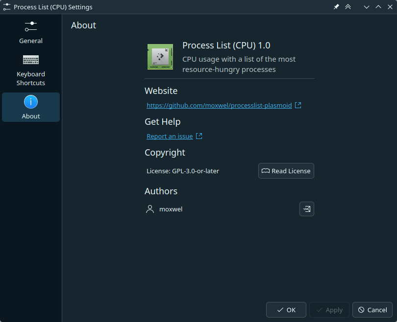
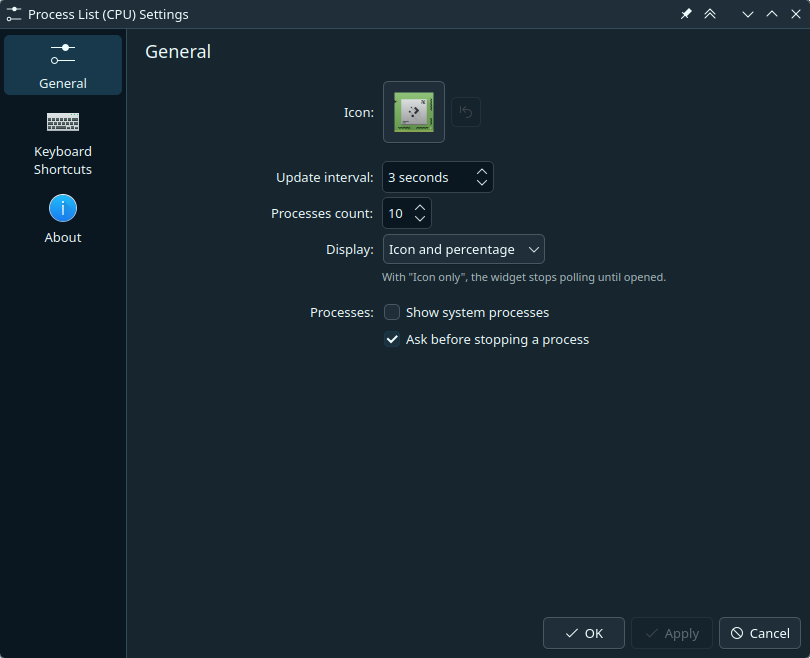

# Process List Plasmoid

A KDE Plasma 6 widget that shows CPU or RAM usage with a list of the processes using the most of it.

It installs as two widgets built from the same code, **Process List (CPU)** and **Process List (RAM)**, so you can add either one or both.

> This is a learning project to help me learn more about KDE Plasma development, so I welcome any feedback or suggestions.

## Screenshots

### Usage


<p>
  
  
</p>

### Settings

<p>
  
  
</p>

## Install

```sh
./install.sh
```

Then right-click your panel > *Add or Manage Widgets...* > search for **Process List** and drag the CPU or RAM widget onto the panel or the desktop.

Re-run `./install.sh` after editing any file; it rebuilds both widgets, upgrades them and reloads plasmashell in one step.

To uninstall both widgets:

```sh
./install.sh remove
```

## Build

```sh
./build.sh
```

Writes `build/processlist-cpu.plasmoid` and `build/processlist-ram.plasmoid`. Install either from *Add or Manage Widgets...* > *Get New* > *Install Widget From Local File...*.

> [!TIP]
> Bump `Version` in `metadata.json` before each release, otherwise Plasma does not offer the update.

## Usage

Click the widget to open the list. The header shows the total usage, the update interval and, for RAM, the memory in use. Its buttons open System Monitor, pause the list, refresh it right away and keep the popup open.

Each row shows the process name, its command (hover to read all of it), its PID and its usage. The stop button ends the process with `kill`, but only if it already existed when the list was taken, so a PID reused by a new process is spared.

In a panel the list only updates while the popup is open; the rest of the time the widget reads just the total usage. On the desktop the list is always on screen.

## Settings

- **Icon**: the icon shown in the panel, with a button to go back to the default one.
- **Update interval**: seconds between samples, 3 by default.
- **Processes count**: how many processes the list shows, from 1 to 10, 5 by default.
- **Display**: what the panel shows: icon only, percentage only, icon and percentage, or text and percentage. With "Icon only" the widget stops polling until it is opened.
- **Show system processes**: also list processes owned by other users. Off by default.
- **Ask before stopping a process**: on by default.

## Requirements

- Plasma 6 (developed and tested against 6.7.5)
- `kpackagetool6` (ships with KDE Frameworks 6)
- `top` from procps-ng, which the widget runs to read the process list
- `gettext` to compile translations in `translate/` (`install.sh`, `build.sh`)
- `zip` (`install.sh`, `build.sh`)
- `plasma-systemmonitor` for the *Open System Monitor* button (optional)

## AI usage disclosure

I want to provide transparency and honesty about the use of AI in this project.

This project has been developed with the assistance of AI tools. AI was used to generate code snippets and documentation.

**ALL AI-generated content** has been **manually reviewed** and **edited by me (moxwel)**, to ensure code accuracy, readability, and quality with my personal standard coding practices.

## License

GPL-3.0-or-later. See [LICENSE](LICENSE).
